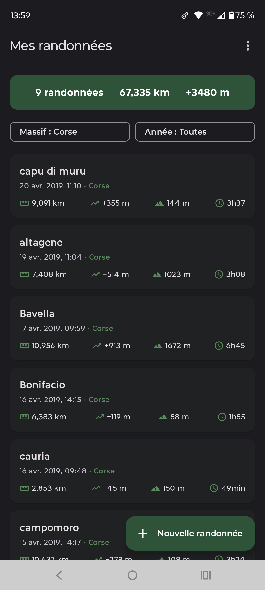
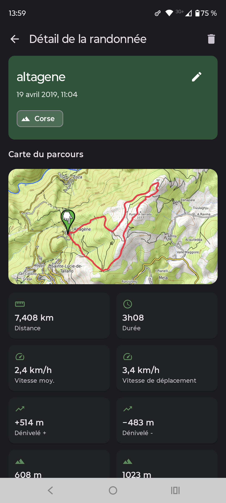
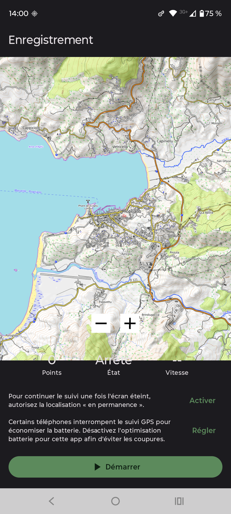

# Rando GPX

*[English version](README.en.md)*

Application Android d'enregistrement de randonnées, **libre et sans dépendance
à Google Play Services**. Localisation via l'API Android standard
(`LocationManager`), aucun tracker, aucune télémétrie.

## Captures d'écran

<p float="left">
  
  
  
</p>

## Fonctionnalités

- Enregistrement GPS en arrière-plan (écran éteint), avec notification affichant distance et durée en direct
- Suivi en direct sur une carte (fonds OpenTopoMap, orientés randonnée)
- Correction d'altitude par géoïde EGM96, pour un dénivelé plus fidèle que l'altitude GPS brute
- Export et import au format GPX 1.1 standard
- Historique des randonnées avec statistiques détaillées : distance, dénivelé, vitesse moyenne et vitesse de déplacement (hors arrêts), altitude min/max, durée
- Carte de relecture du parcours complet et profil d'élévation pour chaque randonnée
- Classement des randonnées par massif, avec filtres par massif et par année
- Sélection d'une zone de carte à rendre disponible hors ligne
- Interface en français et en anglais, sélectionnée automatiquement selon la langue du téléphone

## Installation

### Depuis les sources

```bash
git clone <url-du-depot>
cd rando-gpx
./gradlew :app:assembleDebug
```

Ouvrir le dossier dans Android Studio fonctionne aussi directement. Nécessite
un appareil ou émulateur Android 8.0+ (minSdk 26).

### F-Droid

À venir — l'application est en cours de préparation pour une soumission au
dépôt officiel F-Droid.

## Confidentialité et licences

- Aucune dépendance à Google Play Services : la géolocalisation utilise
  l'API Android standard (`LocationManager`), pas `FusedLocationProviderClient`
- Aucun SDK d'analyse ou de tracking
- Toutes les dépendances (AndroidX, [osmdroid](https://github.com/osmdroid/osmdroid),
  [MPAndroidChart](https://github.com/PhilJay/MPAndroidChart)) sont libres
- Grille géoïde EGM96 : distribution [GeographicLib](https://geographiclib.sourceforge.io/)
  (licence BSD) des données publiques NGA WW15MGH
- Projet sous licence **GNU GPL v3.0 ou ultérieure** — voir [LICENSE](LICENSE)

## Contribuer

Les retours, rapports de bug et suggestions sont bienvenus via les issues du
dépôt.
